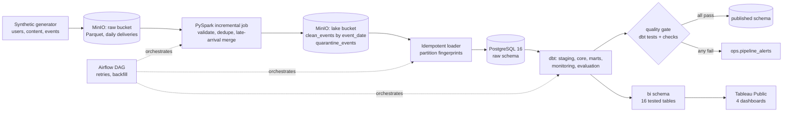

# Social Product Analytics Warehouse

**Incremental ELT, data modeling and observability for a social-app event stream.**

> **All data in this repository is SYNTHETIC.** It is produced by `src/generate_data.py` (seed 42) so that every
> pipeline behaviour can be checked against *known, injected* ground truth. No real users, no real product,
> no real company data. All numbers below were measured by running this repository locally.



## What it does

1. **Generates** 40 days of events for 70,000 users with deliberately awkward properties: events that arrive
   1-3 days late, duplicate deliveries, malformed rows, users whose country/device/segment change over time, and
   15 creators whose engagement declines from a known onset date.
2. **Ingests** each daily delivery with PySpark into an object-storage lake (MinIO). Late events land in the
   correct *event-date* partition; bad rows go to a quarantine table with a reject reason; a batch whose reject
   rate exceeds 1% is blocked.
3. **Loads** the lake into PostgreSQL incrementally. Only partitions whose content fingerprint changed are reloaded.
4. **Models** the data with dbt: staging views, a Type 2 slowly changing user dimension, incremental fact tables,
   marts (growth, retention, creator alerts), monitoring tables and an evaluation layer.
5. **Orchestrates** the daily run with Airflow: retries, a backfill path, a quality gate before anything is
   published, and failure alerts that record the real cause.
6. **Evaluates** a creator engagement-decline alert against the planted ground truth (precision, recall, delay).
7. **Serves** 16 tested `bi` tables to a four-page Tableau Public workbook (KPIs, content performance, creator alerts,
   data quality and pipeline status); the headline numbers are reconciled to `bi/export/manifest.json`.

## Measured results

| Area | Result |
|---|---|
| Raw input | 10,648,792 event rows (10,574,791 distinct valid events; 52,605 duplicate deliveries; 21,396 malformed rows; 317,436 late-arriving events), 45 ingest dates |
| Lake reconciliation vs. injected truth | 10 / 10 checks pass (`reports/lake_reconciliation.json`) |
| Re-run and order independence (`make idempotency`) | Re-processing an ingest date leaves `clean_events` unchanged; processing a range newest-first into a scratch lake gives the same `clean_events` as oldest-first |
| dbt | 40 models (24 warehouse models + 16 `bi` tables), 1 seed, 136 data tests: **136 / 136 pass** (83 on the warehouse models, 53 on the `bi` layer) |
| SCD Type 2 | 70,000 users produce 102,641 `dim_users` versions |
| Full dbt build time | 122 s for ~10.6M events on a laptop |
| Airflow daily run | 8 tasks, about 4.5 minutes per ingest date |
| Retry drill | `check_raw_landed` fails once on purpose and succeeds on its automatic retry |
| Quality-gate drill | A batch with 5.89% rejected rows (18,051 null `user_id`) is stopped at the Spark step; nothing downstream runs and `published.*` is untouched. A clean replacement batch then publishes normally |
| BI layer | 16 `bi` tables exported to CSV (`make export-bi`); 4-page Tableau Public workbook, KPIs checked against `manifest.json` and against the CSVs from the command line |
| Backfill drill | Re-processing 2026-08-10 with `reprocess` rebuilds the facts in 8 min and leaves `fct_events` at exactly 10,873,190 rows (before = after) |

## Creator engagement-decline alert: evaluation

**Rule.** A creator is flagged on day *d* when each of the last 3 days of engagement received is at most
0.5 x the mean of the 14 days before them, and that 14-day baseline is at least 20 events/day. Only days whose
late events can no longer arrive are scored.

**Result against the 15 planted declines (synthetic):**

| planted | alerts | true positives | false alarms | missed | precision | recall | median delay |
|---|---|---|---|---|---|---|---|
| 15 | 14 | 12 | 2 | 3 | 0.857 | 0.800 | 2 days (range 2-5) |

**Sensitivity to the threshold** (`sql/alert_sensitivity.sql`, same data):

| ratio | alerts | true positives | false alarms | missed | precision | recall |
|---|---|---|---|---|---|---|
| 0.4 | 6 | 6 | 0 | 9 | 1.000 | 0.400 |
| **0.5 (shipped)** | 14 | 12 | 2 | 3 | 0.857 | 0.800 |
| 0.6 | 35 | 14 | 21 | 1 | 0.400 | 0.933 |
| 0.7 | 180 | 14 | 166 | 0 | 0.078 | 0.933 |

**Read these numbers with care.**

- **The threshold was tuned on this same synthetic dataset**, so 0.857 / 0.800 are in-sample and optimistic.
  They show that the pipeline can recover planted signals; they are not an estimate of performance on real traffic.
- The sensitivity table shows how sharp the trade-off is: a small change in the ratio swings precision from
  0.86 to 0.40.
- Both false alarms are low-volume creators (about 21 events/day on average, right above the 20/day floor), where day-to-day noise is large relative to the signal. The three misses have decline factors of 0.43-0.51 (engagement falls to roughly half), close to the 0.5 line; I did not investigate them further, but with only three days in the window, ordinary noise keeping one day above the line is the likely cause.
- A community-level variant of the same detector exists, but it raised no alerts on this data and is **not evaluated**.

## Dashboards (Tableau Public)

Four pages in `bi/tableau/social_warehouse_dashboard.twbx`, built from the exported `bi` tables. Details, reconciliation and
limits are in [docs/DASHBOARD.md](docs/DASHBOARD.md). The workbook is saved locally and not published.

| | |
|---|---|
|  |  |
| 1. Product KPIs (DAU, WAU, retention, filters by segment, device, date) | 2. Content performance (content type, top communities) |
|  |  |
| 3. Creator engagement-decline alerts | 4. Data quality and pipeline status |

These charts show synthetic data. Patterns in them (weekly seasonality, similar rates across segments, one dominant
community) are generator settings, not findings. Freshness on page 4 is a snapshot taken at export time, not a live monitor.

## Data model

| Layer | Objects | Notes |
|---|---|---|
| `raw` | `events`, `users_snapshot`, `content`, `ops.*` | Loaded from the lake; never edited |
| `staging` | `stg_events`, `stg_user_snapshots`, `stg_content`, `stg_ingest_stats` | Views, light cleanup |
| `core` | `dim_users` (SCD2), `dim_content`, `dim_date`; `fct_events`, `fct_content_engagement`, `fct_creator_daily_metrics` | Facts are incremental: `delete+insert` by `event_date`, trailing 6-day window, or from a given date for backfill |
| `marts` | `mart_daily_growth`, `mart_retention`, `mart_creator_engagement_alerts`, `mart_creator_alert_summary`, `mart_community_engagement_alerts` | Consumer-facing |
| `monitoring` | `mon_data_quality_checks`, `mon_ingest_quality`, `mon_metric_anomalies`, `mon_pipeline_state` | pass / warn / fail checks; any `fail` blocks publication |
| `evaluation` | `eval_creator_alert_detail`, `eval_creator_alert_metrics` | Reads the planted truth (a dbt seed); production models never do |
| `published` | copies of the marts and monitoring tables | Replaced in one transaction, only after the gate passes |

Design reasoning and trade-offs are in [DESIGN.md](DESIGN.md).

## Run it

Requirements: Docker Desktop with several GB of free disk, and Python 3.11+. Developed and run on Apple Silicon.

```bash
python3 -m venv .venv && source .venv/bin/activate
pip install -r requirements-gen.txt
python src/generate_data.py --out data/raw      # ~10.6M events, deterministic (seed 42)

make build                                      # runner image: Spark 3.5, dbt 1.10, Airflow 2.10
make up                                         # MinIO + PostgreSQL
make upload && make ingest && make verify       # raw -> lake, reconciles against injected truth
make idempotency                                # re-run and order-independence experiments
make load                                       # lake -> PostgreSQL
make dbt-seed && make dbt-run && make dbt-test  # models and tests
```

Airflow and the failure drills:

```bash
make airflow-up                                 # UI http://localhost:8080  (admin / admin)
make airflow-run DATE=2026-09-09                # one full daily run
make airflow-run-flaky DATE=2026-09-09          # first attempt fails on purpose, retry succeeds
make batch-bad && make airflow-run DATE=2026-09-10   # quality gate stops a corrupted batch
make batch-good && make airflow-run DATE=2026-09-10  # clean replacement publishes
make airflow-backfill FROM=2026-08-10 TO=2026-08-10  # rebuild facts from a past date
```

Dashboard data (after the dbt run):

```bash
make export-bi                                  # bi/export/*.csv + manifest.json
```

Then open `bi/tableau/social_warehouse_dashboard.twbx` in Tableau Public.

Inspect results: `docker compose exec postgres psql -U wh -d warehouse`.

## Limitations

- **Synthetic data only.** Distributions are simple; real traffic is burstier, has bots and seasonality, and
  would need re-tuned thresholds.
- **40 days** of history. The alert baseline is 14 days; there is no long-horizon seasonality handling.
- **SCD2 is built from daily snapshots**, so attribute changes are visible only at daily granularity.
- **Single-node setup.** Airflow runs a scheduler and web server in one container with `LocalExecutor`; the DAG
  is run through `airflow dags backfill` rather than a live daily schedule; PostgreSQL is one instance.
- **Slack delivery is not exercised.** Alerts are written to `ops.alert_outbox` and logged; posting to a webhook
  only happens if `SLACK_WEBHOOK_URL` is set, and was not tested here.
- **Dashboard limits.** The Tableau workbook is a packaged snapshot of the CSV export, saved locally; filters work only
  within one data source; page 4 freshness is a snapshot; the last four ingest dates are small late-arriving batches, so
  their quarantine rates are not comparable. See [docs/DASHBOARD.md](docs/DASHBOARD.md).
- Row-count and fingerprint checks prove the pipeline is consistent with itself and with the generator's
  ground truth; they say nothing about how well it would match a real source system.

## Repository layout

```
src/        generator, PySpark incremental job, lake verification, Postgres loader, Airflow task code
dbt/        models, macros (incremental window, decline detector), tests, seed (planted truth)
airflow/    DAG
docker/     runner / Airflow image
sql/        warehouse init, alert sensitivity analysis
tests/      unit tests (generator, validation rules, date-window helpers)
reports/    lake reconciliation output
bi/         CSV export of the bi tables, Tableau workbook, DAX measures (reference only)
docs/       dashboard documentation and screenshots
```
