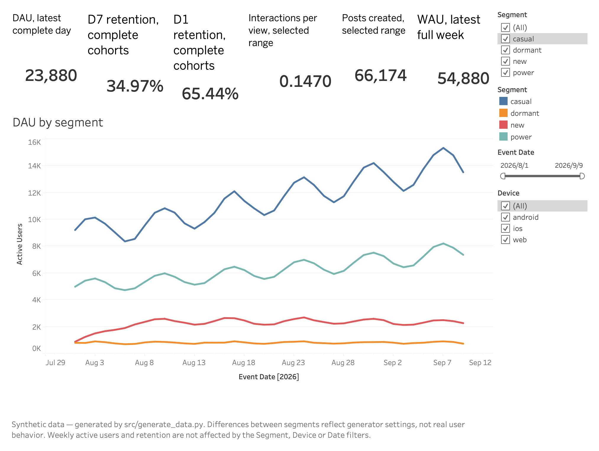
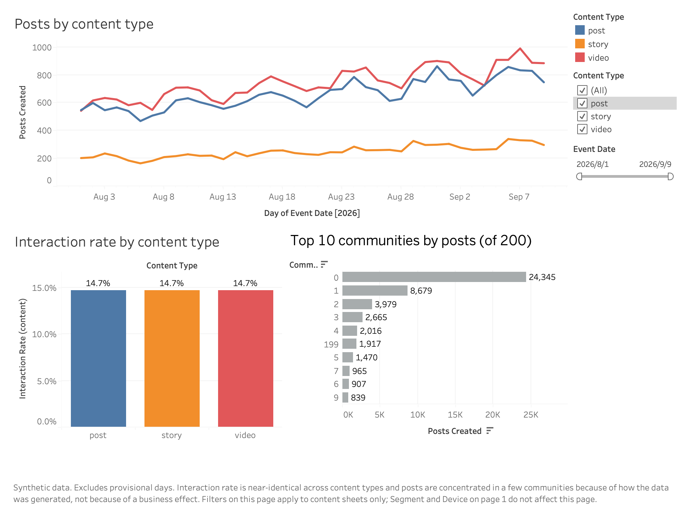
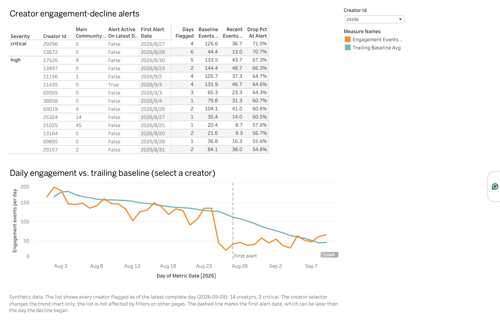
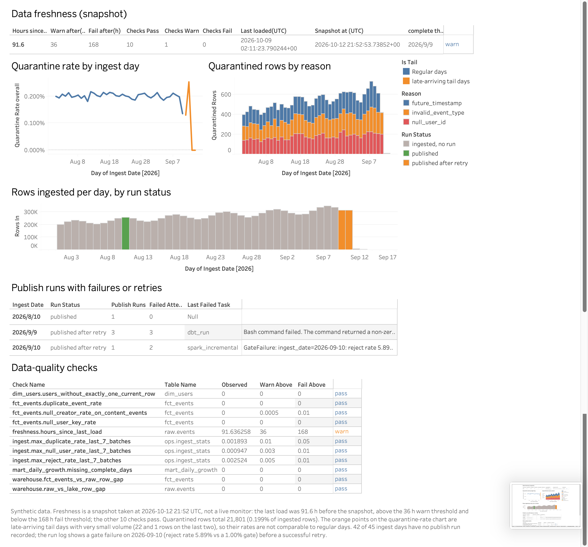

# Dashboard layer (schema `bi`) and Tableau Public workbook

The dashboard is the last layer of the pipeline:

```
raw events -> PySpark (dedup, late data, quarantine) -> MinIO lake -> PostgreSQL -> dbt (staging, core, marts, monitoring)
           -> dbt `bi` schema (16 dashboard-serving tables, tested) -> make export-bi -> CSV -> Tableau Public workbook
```

All data are **synthetic** (generated by `src/generate_data.py`). Differences between segments, devices or content types
in the workbook reflect how the generator was parameterised, not real user behaviour.

The workbook is `bi/tableau/social_warehouse_dashboard.twbx` (Tableau Public, packaged with a copy of the exported CSVs). It
is saved locally and has **not** been published to Tableau Public.

## The four dashboards

### 1. Product KPIs



KPI strip (DAU on the latest complete day, day-7 and day-1 retention, interactions per view, posts created, WAU of the
latest full week) and DAU by segment. Filters: segment, device and event date. Weekly active users and retention are not
affected by these filters (see limits).

### 2. Content Performance



Posts by content type, interaction rate by content type, and the top 10 communities by posts. Filters: content type and
event date (both set as context filters, so the top 10 is computed after them).

### 3. Creator Alerts



The engagement-decline alert list (14 creators: 2 critical, 12 high) and, for the selected creator, daily engagement events
against the trailing baseline with a line at the first alert date. The first alert date can lag the start of the decline,
because the alert fires only after the drop is large enough.

### 4. Data Quality & Pipeline



Freshness, quarantine rate by ingest day, quarantined rows by reason, rows ingested per day by run status, publish runs with
failures or retries, and the 11 data-quality checks (10 pass, 1 warn).

## How the numbers are computed in Tableau

* Ratios are `SUM(numerator) / SUM(denominator)` calculated fields, never an average of averages (for example
  interaction rate = `SUM(Interactions) / SUM(Views)`).
* Provisional days are excluded with a data-source filter (`Is Provisional = False`); the weekly sheet keeps full weeks only.
* Each CSV is its own Tableau data source, so a filter applies to the sheets built on the same source (see limits).

### Checks against the exported CSVs and `bi/export/manifest.json`

| Number | Workbook | Reference |
|---|---|---|
| DAU, latest complete day (2026-09-09) | 23,880 | `manifest.json` |
| WAU, week of 2026-08-31 | 54,880 | `manifest.json` |
| Day-1 / day-7 retention | 65.44% / 34.97% | `manifest.json` |
| Posts created, complete days | 66,174 | `manifest.json` and a command-line sum of the CSV |
| Interactions per view | 0.1470 | `manifest.json` and a command-line ratio per content type |
| Creators alerted (critical) | 14 (2) | `manifest.json` |
| Quarantined rows (share of ingested rows) | 21,801 (0.199%) | `manifest.json` and a command-line sum of reject reasons |
| Hours since last load (snapshot) | 91.6 | `manifest.json` |

## Why a separate `bi` schema

* Facts are **additive** (counts only). Every ratio is computed in the BI tool from sums, so a filter never produces an
  average of averages.
* Segment and device are the values **on that day** (SCD2 lookup), so numbers do not change when a user later changes segment.
* Provisional days (events can still arrive late) are flagged `is_provisional`; the measures exclude them.
* Every fact reconciles to the existing marts by a dbt test (`dbt/tests/assert_bi_*.sql`): daily active users, events, posts,
  views, interactions and new users equal `mart_daily_growth`; weekly active users equal the distinct users per week;
  retention equals `mart_retention`.

## Tables

| Table | Grain | Used for |
|---|---|---|
| `bi_daily_activity` | date x segment x device | DAU, new users, events, posts, views, interactions, creators posting |
| `bi_weekly_active` | week x segment | WAU (a user counted once per week, in the segment of their last active day) |
| `bi_daily_content` | date x community x content type | content creation and engagement |
| `bi_retention_cohorts` | signup date x device | day-1 / day-7 retention (`dN_eligible` marks complete cohorts) |
| `bi_creator_alerts` | creator | engagement-decline alert list |
| `bi_creator_alert_series` | creator x day | drill-down line chart with the alert's own baseline |
| `bi_dq_checks`, `bi_freshness` | check / one row | data-quality status, freshness |
| `bi_dq_ingest_daily`, `bi_dq_reject_reasons` | ingest date (x reason) | quarantined rows and rate |
| `bi_pipeline_runs` | ingest date | run status from `ops.publish_log` and `ops.pipeline_alerts` |
| `bi_dim_date`, `bi_dim_segment`, `bi_dim_device`, `bi_dim_content_type`, `bi_dim_community` | | lookup dimensions (the Tableau filters use the fact columns directly) |

`bi/powerbi/measures.dax` holds the same measures as DAX. It was written as a reference and has not been run in a Power BI
report; the Tableau workbook is the delivered dashboard.

## Reading the data-quality page

* **Freshness is a snapshot, not a live monitor.** `hours_since_last_load` is measured against the export time
  (2026-10-12 21:52 UTC): 91.6 h against a 36 h warn and 168 h fail threshold. It is the only check that warns; the other 10 pass.
* **The last ingest days are not comparable.** The last four ingest dates are late-arriving tail days with very small volume
  (6,935, 3,169, 22 and 1 rows), so their quarantine rates (the 0.25% peak and the zeros) are small-denominator noise.
* **Run status covers only DAG runs.** 42 of 45 ingest days were loaded with `make ingest` and show as `ingested, no run`.
  The 2026-09-10 gate failure (reject rate 5.89% against the 1.00% gate) is the deliberate quality-gate drill from the README
  (`make batch-bad`); the clean replacement batch then published. 2026-09-09 shows a failed `dbt_run` (3 failed attempts)
  before a successful run; its cause is not recorded in this layer.

## Known limits

* Each CSV is a separate Tableau data source, so a filter only affects sheets built on the same source: the segment and device
  filters do not change the weekly or retention numbers (retention cohorts all start as `new`), and the content-type filter
  does not change user activity. A segment x community cut would need a user x content grain and non-additive distinct counts.
* Retention exists for day 1 and day 7 only.
* The alert is a prototype scored on planted declines in synthetic data (threshold tuned in-sample); see `README.md`.
* Patterns visible in the charts (weekly seasonality, near-identical interaction rates across content types and segments, one
  community with about 37% of posts) are generator settings, not findings.
* Rows ingested per day (page 4) are raw rows delivered per ingest date. Their total (10,948,116) is not reconciled to
  `fct_events` (10,873,190) in this layer: the 21,801 quarantined rows explain part of the gap and the rest has not been traced.
* The workbook holds a packaged copy of the CSVs and does not refresh by itself. After `make export-bi` it has to be pointed at
  the new files and saved again.

## Refresh

```bash
make dbt-run && make dbt-test   # builds and tests the bi schema with everything else
make export-bi                  # writes bi/export/*.csv and bi/export/manifest.json
```

`manifest.json` lists reference numbers (DAU on the latest complete day, retention, WAU, alert counts, quarantine rate ...).
The workbook's KPI numbers must match them; that is the acceptance check for the dashboards.
